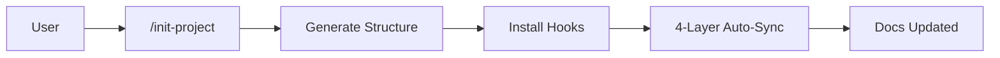

# project-init

[](LICENSE) [](CHANGELOG.md) <a href="#english"></a> <a href="#korean"></a>

A Claude Code plugin for initializing and maintaining project structures with adaptive detection, quality scoring, and auto-sync documentation workflows.

Claude Code 프로젝트 구조 초기화, 문서 품질 점수 평가, 자동 동기화 워크플로우를 지원하는 플러그인입니다.

---

<a id="english"></a>

# English

## Overview

project-init is a Claude Code plugin that automates **project structure generation** and **documentation maintenance**. Claude Code understands project context through `CLAUDE.md` files, but creating and keeping them in sync with code changes is a manual, error-prone process.

The plugin's commands scaffold new or existing projects (`/init-project`), synchronize documentation (`/sync-docs`), generate bilingual README and CHANGELOG files (`/generate-readme`, `/generate-changelog`), add modules (`/add-module`), create runbooks (`/add-runbook`), record architecture decisions (`/add-adr`), add per-layer implementation reference docs (`/add-reference-doc`), validate the project's harness with a percentage score and an A-F grade (`/health-check`), and migrate hooks generated by older versions (`/migrate-hooks`). Documentation quality is measured on a 0-100 scale.

### Harness Engineering

Claude Code operates within a **harness** — the combination of hooks, skills, agents, commands, and `CLAUDE.md` files that shape how Claude behaves in your project. Manually configuring each component is time-consuming and error-prone. project-init automates this harness engineering:

| Harness Component | Generated By | Tier | Purpose |
|---|---|---|---|
| **Hooks** (`settings.json` + `.claude/hooks/`) | `/init-project` | Core: `secret-scan.sh`, `check-doc-sync.sh`; Optional: `session-context.sh`, `notify.sh`, `verify-on-stop.sh` | Deterministic actions on events: block a commit that contains a secret, note a missing module CLAUDE.md, run a fast check before a turn ends |
| **Commands** (`.claude/commands/`) | `/init-project` | Default: `/test-all`, `/review`; Optional: `/deploy` | Shortcuts for repeated tasks; `/deploy` follows your deploy runbook and only you can start it |
| **Agents** (`.claude/agents/`) | `/init-project` | Default: code-reviewer; Optional: security-auditor | Review and audit work in a subagent that inherits your session's model |
| **Skills** (`.claude/skills/`) | `/init-project` | Optional: code-review (replaces `/review` and code-reviewer), refactor, release | Project-specific workflow notes; generic scaffolding that helps most with smaller models |
| **CLAUDE.md** (root + modules) | `/init-project` + `/sync-docs` | Core: root; a module CLAUDE.md only where a module has rules the code does not show | Project context Claude loads at session start (delivered after the system prompt) |

Core components are always generated, Default components unless you uncheck them, and Optional components only when you check them. `/init-project` asks once, in the same question round as the reference-layer selection, and never overwrites an existing file.

In short, project-init is a **harness engineering automation tool** — it generates, configures, and maintains the entire environment that makes Claude Code effective in your project.

## Features

- **Adaptive Project Detection** -- Detects `package.json`, `pyproject.toml`, `go.mod`, `Cargo.toml`, and other build files, and fills in the real commands, source roots, and layout. Existing files are kept; `README.md`, `CHANGELOG.md`, `settings.json`, and `.gitignore` are updated in place.
- **Tiered Generation** -- `/init-project` always writes the Core harness, generates the Default components (`/test-all`, `/review` with the code-reviewer agent) unless you uncheck them, and adds Optional components (`/deploy`, security-auditor, the code-review, refactor, and release skills, and the session-context, notify, and verify-on-stop hooks) only when you check them. Each Optional item says when it helps, and checking the code-review skill replaces `/review` and the code-reviewer agent, so the project keeps one review path.
- **CLAUDE.md Quality Scoring** -- Evaluates documentation across 6 criteria (commands, architecture clarity, non-obvious patterns, conciseness, currency, actionability) on a 0-100 scale with A-F grades, minus anti-pattern deductions such as restated code, hardcoded counts, emphasis inflation, and sections that fail the prune test. Before/After comparison on every sync.
- **Harness Health Score** -- `/health-check` runs the bundled `harness-check.sh` and reports the percentage of applicable points with an A-F grade, the hook-contract status, a CLAUDE.md quality score, the test run, and recommended actions. The deterministic checks give the same score on every run and every model.
- **4-Layer Auto-Sync Workflow** -- The Auto-Sync Rules in a generated CLAUDE.md (guidance Claude applies while it works, when code changes), the generated PostToolUse reminder hook, and the plugin's `/project-init:sync-docs` command keep documentation in step with the code, and the generated Git commit-msg hook keeps AI Co-Authored-By lines out of the commit history.
- **Plan Mode Integration** -- Run `/init-project` after a `/plan` session and the generated structure reflects the architectural decisions discussed, including a pre-filled `architecture.md`.
- **Report-All Code Review** -- The generated `/review` command and code-reviewer agent report every finding with a severity (critical, important, minor) and a confidence score (0-100) and leave the filtering to you, because a confidence cutoff at review time drops real findings.
- **Security-First Hooks** -- The PreToolUse secret scan gates `git commit` and blocks with exit 2. It scans what the commit will contain: staged files including renames, modified tracked files for `commit -a`, `-am`, or a pathspec, and untracked files when the same command line runs `git add`; `git -C <dir>` and `-c` options with quoted values, a `cd` earlier on the line, and chained commands are covered. Patterns (AWS, Stripe, Google, Azure, GitHub, Slack, OpenAI, Anthropic, private keys, and quoted password, secret, and API key values) match with Python `re`, so the gate also works on macOS. Markdown files other than CLAUDE.md, `.env.example`, and lock files are skipped by path, so a key pasted into a README or other doc is not caught; CLAUDE.md files are always scanned. When it cannot scan, for example without a working python3, it lets the commit through and tells you and Claude so. The commit-msg hook removes AI Co-Authored-By lines automatically.
- **Tool Scoping & Deny List** -- Generated `settings.json` denies destructive commands (`rm -rf`, `git push --force`, `eval`, `curl|bash`) with rules like `Bash(rm -rf *)`, keeps `.env` out of Claude's context with `Read(./.env)` rules, and registers every hook as `bash "$CLAUDE_PROJECT_DIR"/.claude/hooks/<name>.sh`, so a gate keeps working after Claude changes directory. It sets neither `model` nor `effortLevel`; the template documents an optional `maxEffortLevel` team cap.
- **Optional Stop Gate** -- `verify-on-stop.sh` runs your fast check (lint, typecheck, or unit tests) when a turn ends on a tree that changed since its last run, and hands failures back to Claude. A tree unchanged since the last run, green or red, is skipped, so a failure comes back once per change instead of on every turn. A run the hook `timeout` kills is reported once in a `systemMessage` instead of counting as checked.
- **Automated Test Framework** -- Generated projects include tests for the hook contract (stdin input, exit 2, gate registration, chained commits), secret scan patterns (TP/FP), and project structure. The tests assert only the components you selected, and the runner sources only its own test directories, so your existing shell tests are left as they are.
- **Structured Agent Output** -- Generated agents are Markdown subagents (`.claude/agents/*.md` with YAML frontmatter). They omit `model`, so they run on your session's model and your team can steer them with `CLAUDE_CODE_SUBAGENT_MODEL`, and they return defined Markdown reports with a Verdict (PASS/WARN/FAIL), a Summary table, and recommendations.
- **Runbook-Driven Operations** -- The optional `/deploy` command follows `docs/runbooks/deploy-*.md` and refuses to deploy without one. `/add-runbook` takes commands from your scripts, Makefile, package scripts, and CI, and marks anything it cannot confirm with `TODO(verify)`.
- **Bilingual Structure Check** -- The document commands run the bundled `check-bilingual.py` on each README, CHANGELOG, architecture doc, ADR, and runbook they write. It checks the language badges, anchors, and identical structure of the English and Korean halves.
- **Implementation reference docs** -- Per-layer skeletons under `docs/reference/` with shared 5-section structure (Overview / Components / Key Decisions / Code Pointers / Cross-references). Auto-detected at init, drift-checked by `/sync-docs`.
- **Mermaid Architecture Diagrams** -- Generated README and architecture docs represent all architecture flows as Mermaid flowcharts that GitHub renders natively: `flowchart TB` with per-layer subgraphs for the full diagram, `flowchart LR` for the critical path.

## Architecture

The critical flow: `/init-project` scaffolds the structure, then the 4-layer auto-sync workflow keeps documentation current as code evolves.



See [docs/architecture.md](docs/architecture.md) for the full architecture document.

## Prerequisites

- Claude Code CLI (latest version; Opus 5.5 needs Claude Code 2.1.280 or later, Sonnet 5.5 2.1.284, Haiku 5.5 2.1.293, and the optional `maxEffortLevel` setting 2.1.267)
- Git
- Python 3 (the generated hooks and the bundled checks use it; without it the secret gate lets commits through with a warning)

## Installation

### Install

From the terminal (shell):

```bash
claude plugin marketplace add https://github.com/whchoi98/project-init
claude plugin install project-init@project-init
```

Or from inside a Claude Code session:

```text
/plugin marketplace add https://github.com/whchoi98/project-init
/plugin install project-init@project-init
```

### Verify

From the terminal:

```bash
claude plugin list
```

Or from inside a Claude Code session:

```text
/plugin list
```

### Update

From the terminal:

```bash
claude plugin marketplace update project-init
claude plugin install project-init@project-init
```

Or from inside a Claude Code session:

```text
/plugin marketplace update project-init
/plugin install project-init@project-init
```

### Uninstall

From the terminal:

```bash
claude plugin remove project-init@project-init
claude plugin marketplace remove project-init
```

Or from inside a Claude Code session:

```text
/plugin remove project-init@project-init
/plugin marketplace remove project-init
```

### From Source (For Development)

```bash
git clone https://github.com/whchoi98/project-init.git
cd project-init
bash scripts/setup.sh
```

> **Note:** After installation, restart your Claude Code session. `/init-project .` keeps existing files, creates only what is missing, and merges missing deny rules and hook registrations into an existing `settings.json`. For a project set up by an older version, run `/project-init:migrate-hooks` — see [Troubleshooting](#troubleshooting-en).

## Usage

```bash
# Initialize a new project
/init-project ./my-new-project

# Initialize Claude Code structure in an existing project
/init-project ./existing-app

# Synchronize all documentation with quality scoring
/sync-docs

# Add a new module with CLAUDE.md and architecture doc update
/add-module src/auth

# Create an operational runbook
/add-runbook deploy-production

# Record an architecture decision
/add-adr use-postgresql

# Add an implementation reference doc for a layer
/add-reference-doc api

# Generate bilingual README.md
/generate-readme

# Generate bilingual CHANGELOG.md (update unreleased or release version)
/generate-changelog
/generate-changelog 2.4.0

# Score the project's harness
/health-check

# Preview the hook migration for a project set up by an older version
/migrate-hooks --dry-run
```

### Example Output

```text
$ /sync-docs

## Sync Report

### Quality Scores (Before -> After)
- ./CLAUDE.md: B (82) -> B (87)
- ./src/api/CLAUDE.md: C (62) -> C (69)
- ./src/auth/CLAUDE.md: -- -> C (58) [NEW]

### Changes Made
- Created: src/auth/CLAUDE.md
- Updated: CLAUDE.md, src/api/CLAUDE.md, docs/architecture.md

### Suggested ADRs
- ADR-004: Adopt Redis for session caching (from commit abc1234) - run /add-adr "Adopt Redis for session caching"

### Runbooks
- Missing: deploy-production.md (Dockerfile present) - run /add-runbook deploy-production
```

### Plan Mode Workflow

Run a planning session before initialization to generate a context-aware project structure:

```text
/plan                              # Enter Plan mode
# Discuss architecture, modules, tech choices with Claude
# Exit Plan mode

/init-project ./my-api             # Generated structure reflects all decisions
```

| Item | Without Plan | With Plan |
|------|-------------|-----------|
| CLAUDE.md Overview | Asks user interactively | Extracted from discussion |
| Module structure | Defaults (api, persistence) | Custom (api, auth, persistence, etc.) |
| architecture.md | Empty template | Pre-filled with data flow and components |
| Key Design Decisions | Empty | Filled from the decisions discussed |

### Recommended Workflow (with Superpowers)

The most effective workflow is to run `/init-project` **after implementation**, not before. When code already exists, the plugin's auto-detection produces far more accurate results.

```text
1. /brainstorm        → Explore requirements, design, and trade-offs
2. /write-plan        → Create a concrete implementation plan
3. /execute-plan      → Implement the code
4. /init-project      → Generate documentation and maintenance infrastructure
5. /sync-docs         → Verify quality scores and fill gaps
```

**Why this order works better:**

| What /init-project generates | Before code exists | After code exists |
|-----|-----|-----|
| CLAUDE.md | Guesses based on user input | Reflects actual structure |
| architecture.md | Empty template | Real components and data flows |
| Module CLAUDE.md | Guessed from planned directories | Only for real modules with rules the code does not show |
| Hooks (doc-sync) | Watch paths unclear | Precise path monitoring |
| Commands (test-all) | Framework guessed | Exact test commands |

`/init-project` is most valuable as a **"project maturation"** step — wrapping working code with documentation, hooks, and maintenance tooling. The plugin's adaptive detection (reading `package.json`, `go.mod`, directory layout) is maximized when real code is present.

### Commands Reference

| Command | Description |
|---------|-------------|
| `/project-init:init-project [path]` | Initialize a Claude Code project structure by tier (Core, Default, Optional). Detects existing projects and adapts. User-invoked only. |
| `/project-init:sync-docs` | Audit all documentation once, fix what the audit found, run the bilingual check, and report quality scores before and after. |
| `/project-init:generate-readme` | Generate or update a bilingual (EN/KR) README.md with auto-detection and shields.io badges. |
| `/project-init:generate-changelog` | Generate or update a bilingual (EN/KR) CHANGELOG.md following Keep a Changelog. |
| `/project-init:add-module <path>` | Add a new module directory, with a CLAUDE.md unless an existing one already covers it, and update architecture docs. |
| `/project-init:add-runbook <name>` | Create an operational runbook with verification and rollback sections. |
| `/project-init:add-adr <title>` | Create an Architecture Decision Record with auto-numbering. |
| `/project-init:add-reference-doc <layer>` | Add a layer-specific implementation reference doc skeleton (`infrastructure`, `data`, `api`, `iac`, `frontend`, `ui`, `security`, `agent-llm`). |
| `/project-init:health-check` | Validate the project's harness and report a score (percentage of applicable points, A-F grade) and a status. Flags hooks that predate the current hook contract. |
| `/project-init:migrate-hooks [--dry-run]` | Migrate older hooks, `settings.json` registrations, and `.yml` agents to the current Claude Code hook contract, with backup. User-invoked only. |

### Command Details

**`/project-init:init-project [path]`** -- Tiered project initialization

Detects the project type (Node.js, Python, Go, Rust, Java/Kotlin), its commands, and its layout, then asks one round of questions: missing project facts, the implementation reference layers, the Default and Optional components, missing README fields, and git. It generates the Core harness (CLAUDE.md, `settings.json` with the deny list and hook registrations, the secret-scan and doc-sync hooks, docs, tests, setup scripts, bilingual README.md and CHANGELOG.md, and `.mcp.json` with no servers) plus the components you kept, without overwriting existing files. It then runs the generated tests, the hook-contract check, and the bilingual check, and prints a summary of what was created, adapted, kept, and skipped. In a new repository it commits only the generated paths; in an existing one it leaves the commit to you. When the project's existing hooks predate the current contract, it recommends `/project-init:migrate-hooks` first. It asks with the AskUserQuestion tool when that is available, so the tools the command pre-approves still apply to the generation that follows.

**`/project-init:sync-docs`** -- Audit, apply, check, report

Audits once: inline for a small project, otherwise through one run of the doc-sync-checker agent. It then applies the findings per document type (root and module CLAUDE.md, `docs/architecture.md` with Mermaid diagrams, the `docs/reference/INDEX.md` table, README.md, CHANGELOG.md), suggests ADRs and runbooks instead of writing them, runs `check-bilingual.py` on what it wrote, and reports Before/After quality scores with the remaining gaps.

**`/project-init:generate-readme`** -- Bilingual README.md generation

Auto-detects project metadata from manifest files, git remote, and CLAUDE.md. Generates a bilingual (English/Korean) README with shields.io badges, standardized sections (Overview, Features, Architecture, Prerequisites, Installation, Usage, Project Structure, Contributing, License, Contact, plus Configuration, Testing, and API Documentation when the project has environment variables, tests, or an API). Updates existing README by preserving user content and syncing both language sections. Asks only for the fields detection cannot fill, and runs the bilingual check on the result.

**`/project-init:generate-changelog`** -- Bilingual CHANGELOG.md generation

Analyzes git tags and commit history to generate a bilingual (English/Korean) CHANGELOG following Keep a Changelog and Semantic Versioning conventions. Modes: new (full generation), update (add commits to [Unreleased]), and release (move [Unreleased] to a new version). It refuses to release a version that already exists and ends with the `git tag -a` command to run. Category headings (Added, Changed, Fixed, etc.) stay in English per convention.

**`/project-init:add-runbook <name>`** -- Operational runbook creation

Creates `docs/runbooks/<name>.md` from the project's runbook template (or the plugin's) with structured sections: Overview, When to Use, Prerequisites, Procedure (copy-paste ready commands), Verification checklist, Rollback steps. Commands come from the project's scripts, Makefile, package scripts, CI, and IaC; anything it cannot confirm is marked `TODO(verify)`. Updates architecture.md and root CLAUDE.md cross-references.

**`/project-init:add-adr <title>`** -- Architecture Decision Record

Creates `docs/decisions/ADR-NNN-<title>.md` with auto-numbering from the project's ADR template (or the plugin's). Drafts Context, Options Considered (with pros/cons), Decision, and Consequences (positive/negative) from the conversation, CLAUDE.md, and git history, asks once for what it cannot find, and leaves a TODO instead of inventing an option. Marks a superseded ADR and cross-references architecture.md and root CLAUDE.md.

**`/project-init:health-check`** -- Project health validation

Runs the bundled `harness-check.sh`, which checks Core files, Hooks, Hook contract, Harness components, Compatibility, Documentation, Security, and Tests, and reports the percentage of applicable points as the score. Grades: A (>= 80%), B (>= 60%), C (>= 40%), D (>= 20%), F (< 20%). The model adds the judgment the script cannot make: a CLAUDE.md quality score out of 100, a verdict on each secret-pattern match, one run of `tests/run-all.sh`, and recommended actions ordered by impact. The status is CRITICAL, NEEDS ATTENTION, or HEALTHY; a hook on the pre-v2.3 contract, a `secret-scan.sh` without the commit-scope fix, or a `check-doc-sync.sh` without the module-coverage fix leads to `/project-init:migrate-hooks`. Module CLAUDE.md coverage is a report worth no points: the model recommends `/project-init:add-module` only for a module with rules its code does not show.

**`/project-init:migrate-hooks [--dry-run]`** -- Hook contract migration

Detects what needs migrating with `harness-check.sh --contract-only`, backs up `.claude/hooks/`, `settings.json`, and `.claude/agents/` to `.claude/backup-<timestamp>/`, regenerates the affected hook scripts from the current templates (carrying over custom `PATTERNS`, `SKIP_PATTERNS`, and `SOURCE_ROOTS`), rewrites every project-init hook registration in `settings.json` to the `bash "$CLAUDE_PROJECT_DIR"/.claude/hooks/<name>.sh` form, converts `.yml` agents to Markdown subagents, and verifies the result with the contract check, sample stdin events, and the test suite. It also migrates a `secret-scan.sh` generated before the commit-scope fix and a `check-doc-sync.sh` generated before the module-coverage fix. `--dry-run` prints the plan without writing.

### Skills and Agents

| Type | Name | Invocation | Role |
|------|------|-----------|------|
| Skill | `project-scaffolder` | Auto-referenced by Claude | Project structure patterns and conventions |
| Agent | `doc-sync-checker` | Launched once by `/sync-docs` for larger projects (inherits the session model, `effort: medium`) | Documentation gap analysis, quality scoring, anti-pattern detection |

## Project Structure

```text
project-init/                              # Marketplace root
├── .claude-plugin/
│   └── marketplace.json                   # Marketplace manifest (v2.4.0)
├── LICENSE                                # MIT License
├── README.md
└── plugins/
    └── project-init/                      # Plugin package (v2.4.0)
        ├── .claude-plugin/
        │   └── plugin.json                # Plugin manifest
        ├── commands/
        │   ├── init-project.md            # /init-project command
        │   ├── sync-docs.md               # /sync-docs command
        │   ├── generate-readme.md         # /generate-readme command
        │   ├── generate-changelog.md      # /generate-changelog command
        │   ├── add-module.md              # /add-module command
        │   ├── add-runbook.md             # /add-runbook command
        │   ├── add-adr.md                 # /add-adr command
        │   ├── add-reference-doc.md       # /add-reference-doc command
        │   ├── health-check.md            # /health-check command
        │   └── migrate-hooks.md           # /migrate-hooks command
        ├── agents/
        │   └── doc-sync-checker.md        # Documentation sync checker agent
        ├── scripts/
        │   ├── harness-check.sh           # Harness checks and score (/health-check, /migrate-hooks)
        │   └── check-bilingual.py         # Bilingual document structure check
        └── skills/
            └── project-scaffolder/
                ├── SKILL.md               # Structure pattern knowledge skill
                └── references/            # Template reference files
                    ├── writing-style-guide.md
                    ├── claude-md-template.md
                    ├── docs-templates.md
                    ├── hook-scripts.md
                    ├── settings-json-template.md
                    ├── skills-templates.md
                    ├── agents-templates.md
                    ├── mcp-json-template.md
                    ├── scripts-templates.md
                    ├── tests-templates.md
                    ├── readme-template.md
                    ├── changelog-template.md
                    └── reference-doc-template.md
```

### Generated Project Structure

Running `/init-project` on a new project creates the Core files below, plus the Default components unless you uncheck them and the Optional components you check:

```text
project/
├── CLAUDE.md                          # Core: project memory + Auto-Sync Rules
├── README.md                          # Core: bilingual
├── CHANGELOG.md                       # Core: bilingual, Keep a Changelog
├── .gitignore                         # Core
├── .env.example                       # Core: environment variable template
├── .editorconfig                      # Core: editor formatting rules
├── .mcp.json                          # Core: {"mcpServers": {}} until you add servers
├── docs/
│   ├── architecture.md                # Core: architecture document
│   ├── onboarding.md                  # Core: new developer onboarding guide
│   ├── api-reference.md               # Core, only when an API is detected
│   ├── decisions/.template.md         # Core: ADR template
│   ├── runbooks/.template.md          # Core: runbook template
│   └── reference/                     # Core: one doc per selected layer, plus INDEX.md
├── .claude/
│   ├── settings.json                  # Core: deny list + hook registrations
│   ├── hooks/
│   │   ├── secret-scan.sh             # Core: PreToolUse gate on git commit
│   │   ├── check-doc-sync.sh          # Core: PostToolUse module CLAUDE.md reminder
│   │   ├── session-context.sh         # Optional: SessionStart environment notes
│   │   ├── notify.sh                  # Optional: Notification webhook
│   │   └── verify-on-stop.sh          # Optional: Stop gate that runs the fast check
│   ├── commands/
│   │   ├── test-all.md                # Default: runs the detected test command
│   │   ├── review.md                  # Default: reviews the current changes
│   │   └── deploy.md                  # Optional: follows the deploy runbook, user-invoked only
│   ├── agents/
│   │   ├── code-reviewer.md           # Default: used by /review
│   │   └── security-auditor.md        # Optional: security audit
│   └── skills/                        # Optional: code-review, refactor, release
├── scripts/
│   ├── setup.sh                       # Core: project setup for new developers
│   └── install-hooks.sh               # Core: Git commit-msg hook installer
├── tests/
│   ├── run-all.sh                     # Core: test runner
│   ├── hooks/
│   │   ├── test-hooks.sh              # Hook contract tests
│   │   └── test-secret-patterns.sh    # Secret TP/FP tests
│   ├── structure/
│   │   └── test-plugin-structure.sh   # File and CLAUDE.md validation
│   └── fixtures/                      # Test data (secret samples)
└── src/                               # New projects only: the layout from your answers
    └── <module>/CLAUDE.md             # Only for a module with rules the code does not show
```

### Existing Project Detection

| File Found | Project Type | Source Dirs | Auto-filled Commands |
|-----------|-------------|-------------|---------------------|
| `package.json` | Node.js | src/, app/, lib/, components/ | npm/yarn/pnpm scripts |
| `pyproject.toml` | Python | src/, app/, lib/ | pip, pytest, ruff |
| `go.mod` | Go | cmd/, pkg/, internal/ | go build, go test |
| `Cargo.toml` | Rust | src/ | cargo build, cargo test |
| `pom.xml` / `build.gradle` | Java/Kotlin | src/main/, src/test/ | mvn, gradle |
| None | New project | src/api/, src/persistence/ | (ask user) |

### Auto-Sync Mechanisms

| Mechanism | Trigger | Type | Location |
|-----------|---------|------|----------|
| Auto-Sync Rules | Code changes, while Claude works | Guidance | `CLAUDE.md` |
| PostToolUse Hook | After Write/Edit | Auto | `.claude/settings.json` + `.claude/hooks/` |
| /sync-docs | User invocation | Manual | Plugin command |
| commit-msg Hook | git commit | Auto | `.git/hooks/commit-msg` |

### CLAUDE.md Quality Scoring

`/sync-docs`, `/health-check`, and `doc-sync-checker` evaluate each CLAUDE.md on a 100-point scale, with the rubric in `## CLAUDE.md Quality Criteria` of the project-scaffolder `SKILL.md`:

| Criterion | Max Score | Description |
|-----------|-----------|-------------|
| Commands/workflows | 20 | Build, test, and deploy commands present and copy-paste ready, including a way to verify a change |
| Architecture clarity | 20 | What the code does not make obvious: boundaries, entry points, where things live |
| Non-obvious patterns | 15 | Gotchas, quirks, and conventions that differ from the defaults, each with its reason |
| Conciseness | 15 | Every line passes the prune test; nothing Claude can read from the code or config |
| Currency | 15 | Matches the current code, commands, and dependencies |
| Actionability | 15 | Instructions are concrete and executable, not vague |

Grades: A (90-100), B (70-89), C (50-69), D (30-49), F (0-29)

Anti-pattern deductions are subtracted from the total: restating what the code or config shows, hardcoded counts, versions, or dates, emphasis inflation or rules without reasons, verification scaffolding, vague instructions, secrets, stale commands, and sections that fail the prune test. Length alone is not a deduction.

<a id="troubleshooting-en"></a>

## Troubleshooting

**Commands not appearing after installation**
- Restart your Claude Code session completely (exit and re-enter)
- Verify the plugin is installed: `claude plugin list`
- Check that the marketplace path is correct: `claude plugin marketplace list`

**`/init-project` overwrites existing files**
- It does not: an existing file is kept and listed as `(existing, kept)` in the summary
- `README.md`, `CHANGELOG.md`, `settings.json` (missing deny rules and hook registrations), `.gitignore`, and the AUTO-MANAGED regions are updated in place
- Use on a clean directory if you want a fresh structure

**`/sync-docs` quality scores seem low**
- Scores reflect documentation completeness, not code quality
- Focus on adding copy-paste ready commands (20 points) and architecture clarity (20 points) first
- Run `/sync-docs` again after updates to see Before/After improvement

**`settings.json` errors on session start ("Invalid key in record" or "Invalid permission rule")**
- This was caused by two bugs fixed in v2.1: `PreCommit` (invalid hook event) and `Bash(python3 -c:*import os*)` (invalid deny pattern syntax)
- If your project was initialized before v2.1, manually update `.claude/settings.json`:
  ```diff
  - "Bash(python3 -c:*import os*)"
  + "Bash(python3 -c*import os*)"
  ```
  ```diff
  - "PreCommit": [
  -   { "matcher": "",
  + "PreToolUse": [
  +   { "matcher": "Bash",
  ```
- Hook event names must come from the Claude Code hooks reference (for example `PreToolUse`, `PostToolUse`, `SessionStart`, `Stop`, `Notification`); a hook under any other name never fires, and `/project-init:health-check` warns about it
- `Bash(git log:*)` is equivalent to `Bash(git log *)`, but `:*` works only at the end of a pattern; the generated settings use the space form

**Generated hooks never fire, or `secret-scan.sh` does not block commits (projects initialized before v2.3)**
- Hooks generated before v2.3 read `$TOOL_INPUT_PATH`, `$EVENT`, and `$MESSAGE`, which Claude Code never sets; hook events arrive as JSON on stdin. `secret-scan.sh` also exited 1 inside `|| true`, which Claude Code treats as non-blocking.
- Run `/project-init:migrate-hooks` (add `--dry-run` to preview). It backs up and rewrites everything below in one pass. Manual steps, if preferred: regenerate the hook scripts from the current `hook-scripts.md` template, then update `.claude/settings.json`:
  ```diff
  - "command": "bash .claude/hooks/secret-scan.sh 2>/dev/null || true"
  + "command": "bash \"$CLAUDE_PROJECT_DIR\"/.claude/hooks/secret-scan.sh"
  - "command": "bash .claude/hooks/check-doc-sync.sh \"$TOOL_INPUT_PATH\" 2>/dev/null || true"
  + "command": "bash \"$CLAUDE_PROJECT_DIR\"/.claude/hooks/check-doc-sync.sh 2>/dev/null || true"
  ```
- Rename `.claude/agents/*.yml` to `.md` and give each file YAML frontmatter plus a Markdown body (see `agents-templates.md`); Claude Code does not load `.yml` subagents.

**`git add . && git commit` or `git commit -am` passes `secret-scan.sh` (projects initialized with v2.4.0 or earlier)**
- The older `secret-scan.sh` scanned only files staged before the command ran, missed renamed files and git options with quoted values, and its `grep -P` matching fails on macOS. A relative registration (`bash .claude/hooks/secret-scan.sh`) also stops working once Claude changes into a subdirectory.
- `/project-init:health-check` reports this as `secret-scan-scope`. Run `/project-init:migrate-hooks`: it regenerates `secret-scan.sh`, keeps your custom `PATTERNS` and `SKIP_PATTERNS` entries, and rewrites the registrations to the `$CLAUDE_PROJECT_DIR` form.

**`check-doc-sync.sh` asks for a CLAUDE.md in every subdirectory (`doc-sync-scope`)**
- A `check-doc-sync.sh` generated before the module-coverage fix asks for a CLAUDE.md in each directory it sees instead of naming the first-level module, repeats "No ADRs found" after every edit, and goes quiet once Claude changes into a subdirectory.
- `/project-init:health-check` reports this as `doc-sync-scope`. Run `/project-init:migrate-hooks`: it regenerates `check-doc-sync.sh` and keeps your `SOURCE_ROOTS`.

**Commits fail on macOS with `sed: ... invalid command code` (commit-msg hook)**
- The commit-msg hook that older versions installed runs `sed -i` without a backup suffix, which BSD sed rejects, so every commit aborts.
- Run `bash scripts/install-hooks.sh` again; it replaces the project's own hook. When `core.hooksPath` points at a hook manager such as husky, the script installs nothing, prints the line to add to that manager's commit-msg hook, and exits 1.

**Claude keeps working at the end of a turn (`verify-on-stop.sh`)**
- The Stop gate found a failing fast check and handed the failure back to Claude. Fix the failure, or tell Claude why it should stay red. The gate runs again only after the tree changes, so an unchanged red tree lets the next turn end.
- If the check was already failing before `/init-project`, fix it first, or remove the `Stop` registration from `.claude/settings.json` until it passes.

**`doc-sync-checker` agent timeout**
- `/sync-docs` launches the agent only for projects with more than about ten CLAUDE.md and documentation files; smaller projects are audited inline
- The agent inherits the session's model and runs at `effort: medium`; to run it on another model, set `CLAUDE_CODE_SUBAGENT_MODEL` (for example `haiku` for a lower-cost audit; on Amazon Bedrock, Google Cloud, and Microsoft Foundry `haiku` resolves to Haiku 4.5)

## Contributing

Contributions use the fork and pull request flow below. [CONTRIBUTING.md](CONTRIBUTING.md) also covers the commit prefixes, the plugin structure, the rules for writing commands, and the review checklist.

1. Fork the repository.
2. Create a feature branch.
   ```bash
   git checkout -b feat/my-feature
   ```
3. Commit your changes using Conventional Commits.
   ```bash
   git commit -m "feat: add support for Rust project detection"
   ```
4. Push to your fork.
   ```bash
   git push origin feat/my-feature
   ```
5. Open a Pull Request against the `main` branch.

## License

This project is licensed under the MIT License. See the [LICENSE](LICENSE) file for details.

## Contact

- Maintainer: [whchoi98](https://github.com/whchoi98)
- Email: whchoi98@gmail.com
- Issues: [GitHub Issues](https://github.com/whchoi98/project-init/issues)

---

<a id="korean"></a>

# 한국어

## 개요

project-init은 Claude Code 프로젝트의 **구조 생성**과 **문서 유지보수**를 자동화하는 플러그인입니다. Claude Code는 `CLAUDE.md` 파일을 통해 프로젝트 컨텍스트를 이해하지만, 이를 생성하고 코드 변경에 맞춰 동기화하는 과정은 수동적이고 실수가 잦습니다.

이 플러그인의 커맨드는 신규/기존 프로젝트 스캐폴딩(`/init-project`), 문서 동기화(`/sync-docs`), 이중 언어 README와 CHANGELOG 생성(`/generate-readme`, `/generate-changelog`), 모듈 추가(`/add-module`), 운영 런북 생성(`/add-runbook`), 아키텍처 결정 기록(`/add-adr`), 계층별 구현 참조 문서 추가(`/add-reference-doc`), 백분율 점수와 A-F 등급을 통한 프로젝트 하네스 검증(`/health-check`), 이전 버전이 생성한 훅 마이그레이션(`/migrate-hooks`)을 제공합니다. 문서 품질은 0-100점 척도로 측정합니다.

### 하네스 엔지니어링

Claude Code는 **하네스(Harness)** 위에서 동작합니다 — hooks, skills, agents, commands, `CLAUDE.md` 파일의 조합이 프로젝트에서 Claude의 행동을 결정합니다. 각 구성 요소를 수동으로 설정하는 것은 시간이 많이 들고 실수하기 쉽습니다. project-init은 이 하네스 엔지니어링을 자동화합니다:

| 하네스 구성 요소 | 생성 주체 | 티어 | 역할 |
|---|---|---|---|
| **Hooks** (`settings.json` + `.claude/hooks/`) | `/init-project` | Core: `secret-scan.sh`, `check-doc-sync.sh`; Optional: `session-context.sh`, `notify.sh`, `verify-on-stop.sh` | 이벤트 발생 시 결정론적 동작: 시크릿이 담긴 커밋 차단, 누락된 모듈 CLAUDE.md 알림, 턴 종료 전 빠른 검사 실행 |
| **Commands** (`.claude/commands/`) | `/init-project` | Default: `/test-all`, `/review`; Optional: `/deploy` | 반복 작업의 단축 명령. `/deploy`는 배포 런북을 따르며 사용자만 시작 가능 |
| **Agents** (`.claude/agents/`) | `/init-project` | Default: code-reviewer; Optional: security-auditor | 세션 모델을 상속하는 서브에이전트에서 리뷰·감사 수행 |
| **Skills** (`.claude/skills/`) | `/init-project` | Optional: code-review(`/review`와 code-reviewer를 대체), refactor, release | 프로젝트 고유 워크플로우 메모. 작은 모델에서 가장 유용한 범용 스캐폴딩 |
| **CLAUDE.md** (루트 + 모듈별) | `/init-project` + `/sync-docs` | Core: 루트. 모듈 CLAUDE.md는 코드가 보여 주지 않는 규칙이 있는 모듈에만 | 세션 시작 시 Claude가 읽는 프로젝트 컨텍스트(시스템 프롬프트 뒤에 전달) |

Core 구성 요소는 항상, Default 구성 요소는 해제하지 않는 한, Optional 구성 요소는 선택할 때만 생성됩니다. `/init-project`는 참조 계층 선택과 같은 질문에서 한 번만 묻고, 기존 파일은 덮어쓰지 않습니다.

요약하면, project-init은 **하네스 엔지니어링 자동화 도구**입니다 — Claude Code가 프로젝트에서 효과적으로 작동하는 데 필요한 전체 환경을 생성하고, 구성하고, 유지합니다.

## 주요 기능

- **기존 프로젝트 적응 감지** -- `package.json`, `pyproject.toml`, `go.mod`, `Cargo.toml` 등 빌드 파일을 감지하여 실제 명령어, 소스 루트, 레이아웃을 채웁니다. 기존 파일은 유지하고, `README.md`, `CHANGELOG.md`, `settings.json`, `.gitignore`는 제자리에서 갱신합니다.
- **티어 생성** -- `/init-project`는 Core 하네스를 항상 생성하고, Default 구성 요소(`/test-all`, code-reviewer 에이전트와 함께하는 `/review`)는 해제하지 않는 한 생성하며, Optional 구성 요소(`/deploy`, security-auditor, code-review·refactor·release 스킬, session-context·notify·verify-on-stop 훅)는 선택할 때만 추가합니다. Optional 항목마다 언제 유용한지 설명하며, code-review 스킬을 선택하면 `/review`와 code-reviewer 에이전트를 대신하므로 리뷰 경로가 하나로 유지됩니다.
- **CLAUDE.md 품질 점수** -- 6가지 기준(명령어, 아키텍처 명확성, 비자명한 패턴, 간결성, 최신성, 실행 가능성)으로 0-100점 척도와 A-F 등급으로 평가하고, 코드 반복, 하드코딩 개수, 강조 남용, prune test를 통과하지 못하는 섹션 같은 안티패턴을 감점합니다. 동기화 시 Before/After 점수를 비교합니다.
- **하네스 건강 점수** -- `/health-check`는 번들된 `harness-check.sh`를 실행해 적용 가능한 점수 대비 백분율과 A-F 등급, 훅 계약 상태, CLAUDE.md 품질 점수, 테스트 실행 결과, 권장 조치를 보고합니다. 결정론적 검사라서 실행할 때마다, 어떤 모델에서든 같은 점수가 나옵니다.
- **4단계 자동 동기화 워크플로우** -- 생성된 CLAUDE.md의 자동 동기화 규칙(Claude가 작업하면서 코드가 바뀔 때 적용하는 지침), 생성된 PostToolUse 알림 훅, 플러그인의 `/project-init:sync-docs` 커맨드가 문서를 코드에 맞춰 유지하고, 생성된 Git commit-msg 훅은 AI Co-Authored-By 라인이 커밋 기록에 남지 않게 합니다.
- **Plan 모드 연동** -- `/plan` 세션 이후 `/init-project`를 실행하면 논의한 아키텍처 결정이 반영된 구조가 생성되며, `architecture.md`가 사전 작성됩니다.
- **모든 finding을 보고하는 코드 리뷰** -- 생성되는 `/review` 커맨드와 code-reviewer 에이전트는 모든 finding을 심각도(critical, important, minor)와 확신도(0-100)와 함께 보고하고 필터링은 사용자에게 맡깁니다. 리뷰 시점에 확신도로 거르면 실제 finding이 누락되기 때문입니다.
- **보안 우선 훅** -- PreToolUse 시크릿 스캔이 `git commit`을 게이트하고 exit 2로 차단합니다. 커밋에 들어갈 내용을 검사합니다: 이름을 바꾼 파일을 포함한 stage된 파일, `commit -a`·`-am`·pathspec이면 수정된 tracked 파일, 같은 명령줄에 `git add`가 있으면 untracked 파일까지 검사하며, 따옴표로 감싼 값을 쓴 `git -C <dir>`·`-c` 옵션, 같은 줄 앞쪽의 `cd`, 체인 명령도 잡습니다. 패턴(AWS, Stripe, Google, Azure, GitHub, Slack, OpenAI, Anthropic, 개인 키, 따옴표로 감싼 password·secret·API key 값)은 Python `re`로 매칭하므로 macOS에서도 동작합니다. CLAUDE.md를 제외한 Markdown 파일, `.env.example`, lock 파일은 경로 기준으로 건너뛰므로 README 같은 문서에 붙여 넣은 키는 잡지 못하며, CLAUDE.md 파일은 항상 검사합니다. 동작하는 python3가 없는 경우처럼 검사할 수 없으면 커밋을 통과시키고 사용자와 Claude에게 그 사실을 알립니다. commit-msg 훅이 AI Co-Authored-By 라인을 자동 제거합니다.
- **도구 범위 제한 및 Deny 목록** -- 생성되는 `settings.json`은 `Bash(rm -rf *)` 같은 규칙으로 위험한 명령어(`rm -rf`, `git push --force`, `eval`, `curl|bash`)를 차단하고, `Read(./.env)` 규칙으로 `.env`를 Claude의 컨텍스트에서 제외하며, 모든 훅을 `bash "$CLAUDE_PROJECT_DIR"/.claude/hooks/<name>.sh`로 등록해 Claude가 디렉터리를 옮겨도 게이트가 계속 동작합니다. `model`과 `effortLevel`은 설정하지 않으며, 템플릿에 선택 사항인 팀 상한 `maxEffortLevel`을 문서화합니다.
- **선택형 Stop 게이트** -- `verify-on-stop.sh`는 마지막 실행 이후 바뀐 트리에서 턴이 끝나면 빠른 검사(lint, typecheck, 단위 테스트)를 실행하고 실패를 Claude에 돌려줍니다. 통과든 실패든 마지막 실행 이후 바뀌지 않은 트리는 건너뛰므로, 실패는 턴마다가 아니라 변경마다 한 번 돌아옵니다. 훅 `timeout`으로 중단된 실행은 검사된 것으로 치지 않고 `systemMessage`로 한 번 알립니다.
- **자동화된 테스트 프레임워크** -- 생성 프로젝트에 훅 계약(stdin 입력, exit 2, 게이트 등록, 체인 커밋), 시크릿 스캔 패턴(TP/FP), 프로젝트 구조를 검증하는 테스트가 포함됩니다. 테스트는 선택한 구성 요소만 검사하고, 러너는 자신의 테스트 디렉터리만 source하므로 기존 셸 테스트는 그대로 둡니다.
- **구조화된 에이전트 출력** -- 생성되는 에이전트는 YAML frontmatter를 가진 Markdown 서브에이전트(`.claude/agents/*.md`)입니다. `model`을 생략하므로 세션 모델로 실행되고 팀은 `CLAUDE_CODE_SUBAGENT_MODEL`로 모델을 지정할 수 있으며, Verdict (PASS/WARN/FAIL), Summary 테이블, 권장 사항을 담은 정의된 Markdown 보고서를 반환합니다.
- **런북 기반 운영** -- 선택형 `/deploy` 커맨드는 `docs/runbooks/deploy-*.md`를 따르고, 런북이 없으면 배포하지 않습니다. `/add-runbook`은 스크립트, Makefile, 패키지 스크립트, CI에서 명령을 가져오고, 확인할 수 없는 부분은 `TODO(verify)`로 표시합니다.
- **이중 언어 구조 검사** -- 문서 커맨드는 작성한 README, CHANGELOG, 아키텍처 문서, ADR, 런북마다 번들된 `check-bilingual.py`를 실행합니다. 언어 배지, 앵커, 영어·한국어 절반의 동일한 구조를 검사합니다.
- **구현 참조 문서** -- `docs/reference/` 하위에 5-섹션 공유 구조(Overview / Components / Key Decisions / Code Pointers / Cross-references)의 계층별 스켈레톤. init 시 자동 감지, `/sync-docs`로 드리프트 점검.
- **Mermaid 아키텍처 다이어그램** -- 생성되는 README와 아키텍처 문서의 모든 아키텍처 흐름을 GitHub이 네이티브로 렌더링하는 Mermaid flowchart로 표현합니다: 전체 다이어그램은 계층별 subgraph를 가진 `flowchart TB`, 핵심 경로는 `flowchart LR`을 사용합니다.

## 아키텍처

핵심 흐름: `/init-project`가 구조를 스캐폴딩하고, 이후 4단계 자동 동기화 워크플로우가 코드 변경에 맞춰 문서를 최신 상태로 유지합니다.


전체 아키텍처 문서는 [docs/architecture.md](docs/architecture.md)를 참조합니다.

## 사전 요구 사항

- Claude Code CLI (최신 버전. Opus 5.5는 Claude Code 2.1.280 이상, Sonnet 5.5는 2.1.284 이상, Haiku 5.5는 2.1.293 이상, 선택 설정 `maxEffortLevel`은 2.1.267 이상 필요)
- Git
- Python 3 (생성되는 훅과 번들 검사가 사용합니다. 없으면 시크릿 게이트가 경고와 함께 커밋을 통과시킵니다)

## 설치 방법

### 설치

터미널(shell)에서:

```bash
claude plugin marketplace add https://github.com/whchoi98/project-init
claude plugin install project-init@project-init
```

또는 Claude Code 세션 내에서:

```text
/plugin marketplace add https://github.com/whchoi98/project-init
/plugin install project-init@project-init
```

### 확인

터미널에서:

```bash
claude plugin list
```

또는 Claude Code 세션 내에서:

```text
/plugin list
```

### 업데이트

터미널에서:

```bash
claude plugin marketplace update project-init
claude plugin install project-init@project-init
```

또는 Claude Code 세션 내에서:

```text
/plugin marketplace update project-init
/plugin install project-init@project-init
```

### 삭제

터미널에서:

```bash
claude plugin remove project-init@project-init
claude plugin marketplace remove project-init
```

또는 Claude Code 세션 내에서:

```text
/plugin remove project-init@project-init
/plugin marketplace remove project-init
```

### 소스에서 설치 (개발용)

```bash
git clone https://github.com/whchoi98/project-init.git
cd project-init
bash scripts/setup.sh
```

> **참고:** 설치 후 Claude Code 세션을 재시작합니다. `/init-project .`은 기존 파일을 유지하고 없는 것만 생성하며, 기존 `settings.json`에는 없는 deny 규칙과 훅 등록만 병합합니다. 이전 버전으로 설정한 프로젝트는 `/project-init:migrate-hooks`를 실행합니다 — [문제 해결](#troubleshooting-ko) 섹션을 참고합니다.

## 사용법

```bash
# 새 프로젝트 초기화
/init-project ./my-new-project

# 기존 프로젝트에 Claude Code 구조 추가
/init-project ./existing-app

# 문서 동기화 및 품질 점수 평가
/sync-docs

# 새 모듈 추가 (CLAUDE.md + 아키텍처 문서 업데이트)
/add-module src/auth

# 운영 런북 생성
/add-runbook deploy-production

# 아키텍처 결정 기록
/add-adr use-postgresql

# 계층별 구현 참조 문서 추가
/add-reference-doc api

# 이중 언어 README.md 생성
/generate-readme

# 이중 언어 CHANGELOG.md 생성 (미릴리스 업데이트 또는 버전 릴리스)
/generate-changelog
/generate-changelog 2.4.0

# 프로젝트 하네스 점수 확인
/health-check

# 이전 버전으로 설정한 프로젝트의 훅 마이그레이션 미리보기
/migrate-hooks --dry-run
```

### 실행 결과 예시

```text
$ /sync-docs

## Sync Report

### Quality Scores (Before -> After)
- ./CLAUDE.md: B (82) -> B (87)
- ./src/api/CLAUDE.md: C (62) -> C (69)
- ./src/auth/CLAUDE.md: -- -> C (58) [NEW]

### Changes Made
- Created: src/auth/CLAUDE.md
- Updated: CLAUDE.md, src/api/CLAUDE.md, docs/architecture.md

### Suggested ADRs
- ADR-004: Adopt Redis for session caching (from commit abc1234) - run /add-adr "Adopt Redis for session caching"

### Runbooks
- Missing: deploy-production.md (Dockerfile present) - run /add-runbook deploy-production
```

### Plan 모드 워크플로우

초기화 전에 Plan 세션을 실행하면 컨텍스트를 반영한 프로젝트 구조가 생성됩니다:

```text
/plan                              # Plan 모드 진입
# Claude와 아키텍처, 모듈, 기술 선택 논의
# Plan 모드 종료

/init-project ./my-api             # 논의 내용이 반영된 구조 생성
```

| 항목 | Plan 없이 실행 | Plan 후 실행 |
|------|---------------|-------------|
| CLAUDE.md 개요 | 사용자에게 대화형으로 질문 | 논의 내용에서 자동 추출 |
| 모듈 구조 | 기본값 (api, persistence) | 합의한 구조 (api, auth, persistence 등) |
| architecture.md | 빈 템플릿 | Data Flow, Components 사전 작성 |
| 주요 설계 결정 | 비어 있음 | 논의한 결정으로 작성 |

### 권장 워크플로우 (Superpowers 연계)

가장 효과적인 워크플로우는 `/init-project`를 코드 구현 **이후에** 실행하는 것입니다. 실제 코드가 존재할 때 플러그인의 자동 감지가 훨씬 정확한 결과를 생성합니다.

```text
1. /brainstorm        → 요구사항, 설계, 트레이드오프 탐색
2. /write-plan        → 구체적인 구현 계획 수립
3. /execute-plan      → 코드 구현
4. /init-project      → 문서화 및 유지보수 인프라 구축
5. /sync-docs         → 품질 점수 확인 및 보완
```

**왜 이 순서가 더 효과적인가:**

| /init-project 생성물 | 코드 구현 전 | 코드 구현 후 |
|-----|-----|-----|
| CLAUDE.md | 사용자 입력 기반 추측 | 실제 구조 반영 |
| architecture.md | 빈 템플릿 | 실제 컴포넌트와 데이터 흐름 |
| Module CLAUDE.md | 계획된 디렉토리로 추측 | 코드가 보여 주지 않는 규칙이 있는 실제 모듈에만 |
| Hooks (doc-sync) | 감시 대상 불명확 | 정확한 경로 감시 |
| Commands (test-all) | 프레임워크 추측 | 정확한 테스트 커맨드 |

`/init-project`는 **"프로젝트 성숙화"** 단계로 가장 큰 가치를 발휘합니다 — 작동하는 코드를 문서, 훅, 유지보수 도구로 감싸는 역할입니다. 플러그인의 적응형 감지(`package.json`, `go.mod`, 디렉토리 레이아웃 읽기)는 실제 코드가 있을 때 최대로 활용됩니다.

### 커맨드 목록

| 커맨드 | 설명 |
|--------|------|
| `/project-init:init-project [path]` | Claude Code 프로젝트 구조를 티어(Core, Default, Optional)별로 초기화합니다. 기존 프로젝트를 감지하여 적응합니다. 사용자만 호출할 수 있습니다. |
| `/project-init:sync-docs` | 모든 문서를 한 번 감사하고, 감사 결과를 반영하고, 이중 언어 검사를 실행한 뒤 전후 품질 점수를 보고합니다. |
| `/project-init:generate-readme` | 이중 언어(EN/KR) README.md를 자동 감지와 shields.io 뱃지로 생성 또는 업데이트합니다. |
| `/project-init:generate-changelog` | Keep a Changelog 규약에 따라 이중 언어(EN/KR) CHANGELOG.md를 생성 또는 업데이트합니다. |
| `/project-init:add-module <path>` | 새 모듈 디렉토리를 추가하고, 기존 CLAUDE.md가 이미 커버하지 않으면 CLAUDE.md를 만들며, 아키텍처 문서를 업데이트합니다. |
| `/project-init:add-runbook <name>` | 검증 및 롤백 섹션을 포함한 운영 런북을 생성합니다. |
| `/project-init:add-adr <title>` | 자동 번호 부여로 아키텍처 결정 기록(ADR)을 생성합니다. |
| `/project-init:add-reference-doc <layer>` | 계층별 구현 참조 문서 스켈레톤 추가 (`infrastructure`, `data`, `api`, `iac`, `frontend`, `ui`, `security`, `agent-llm`). |
| `/project-init:health-check` | 프로젝트 하네스를 검증하고 점수(적용 가능한 점수 대비 백분율, A-F 등급)와 상태를 보고합니다. 현재 훅 계약 이전에 생성된 훅을 표시합니다. |
| `/project-init:migrate-hooks [--dry-run]` | 이전 훅, `settings.json` 등록, `.yml` 에이전트를 현재 Claude Code 훅 계약으로 마이그레이션합니다(백업 포함). 사용자만 호출할 수 있습니다. |

### 커맨드 상세

**`/project-init:init-project [path]`** -- 티어별 프로젝트 초기화

프로젝트 유형(Node.js, Python, Go, Rust, Java/Kotlin), 명령어, 레이아웃을 감지한 뒤 질문을 한 번에 묻습니다: 부족한 프로젝트 정보, 구현 참조 계층, Default·Optional 구성 요소, 부족한 README 필드, git. Core 하네스(CLAUDE.md, deny 목록과 훅 등록을 담은 `settings.json`, 시크릿 스캔·문서 동기화 훅, 문서, 테스트, 설정 스크립트, 이중 언어 README.md와 CHANGELOG.md, 서버가 없는 `.mcp.json`)와 유지한 구성 요소를 기존 파일을 덮어쓰지 않고 생성합니다. 이어서 생성 테스트, 훅 계약 검사, 이중 언어 검사를 실행하고 생성·수정·유지·건너뛴 항목을 요약합니다. 새 저장소에서는 생성한 경로만 커밋하고, 기존 저장소에서는 커밋을 사용자에게 맡깁니다. 프로젝트의 기존 훅이 현재 계약 이전 것이면 `/project-init:migrate-hooks`를 먼저 권합니다. AskUserQuestion 도구가 있으면 그 도구로 물으므로, 커맨드가 사전 승인한 도구가 이어지는 생성 단계에도 그대로 적용됩니다.

**`/project-init:sync-docs`** -- 감사, 적용, 검사, 보고

한 번만 감사합니다: 작은 프로젝트는 직접, 그 외에는 doc-sync-checker 에이전트를 한 번 실행합니다. 이어서 문서 유형별(루트·모듈 CLAUDE.md, Mermaid 다이어그램을 포함한 `docs/architecture.md`, `docs/reference/INDEX.md` 표, README.md, CHANGELOG.md)로 감사 결과를 반영하고, ADR과 런북은 직접 쓰지 않고 제안하며, 작성한 문서에 `check-bilingual.py`를 실행하고, 남은 공백과 함께 Before/After 품질 점수를 보고합니다.

**`/project-init:generate-readme`** -- 이중 언어 README.md 생성

매니페스트 파일, git remote, CLAUDE.md에서 프로젝트 메타데이터를 자동 감지합니다. shields.io 뱃지와 표준화된 섹션(개요, 주요 기능, 아키텍처, 사전 요구 사항, 설치 방법, 사용법, 프로젝트 구조, 기여 방법, 라이선스, 연락처, 그리고 환경 변수·테스트·API가 있을 때의 환경 설정·테스트·API 문서)을 포함한 이중 언어(영어/한국어) README를 생성합니다. 기존 README가 있으면 사용자 콘텐츠를 보존하면서 양쪽 언어 섹션을 동기화합니다. 감지로 채울 수 없는 필드만 묻고, 결과에 이중 언어 검사를 실행합니다.

**`/project-init:generate-changelog`** -- 이중 언어 CHANGELOG.md 생성

git 태그와 커밋 히스토리를 분석하여 Keep a Changelog 및 Semantic Versioning 규약을 따르는 이중 언어(영어/한국어) CHANGELOG를 생성합니다. 모드: new (전체 생성), update (미릴리스에 커밋 추가), release (미릴리스를 새 버전으로 이동). 이미 존재하는 버전의 릴리스는 거부하고, 마지막에 실행할 `git tag -a` 명령을 제시합니다. 변경 유형 헤딩(Added, Changed, Fixed 등)은 규약에 따라 영어를 유지합니다.

**`/project-init:add-runbook <name>`** -- 운영 런북 생성

프로젝트의 런북 템플릿(없으면 플러그인 템플릿)으로 `docs/runbooks/<name>.md`를 구조화된 섹션과 함께 생성합니다: 개요, 사용 시점, 사전 요구 사항, 절차 (복사-붙여넣기 가능한 명령어), 검증 체크리스트, 롤백 절차. 명령은 프로젝트의 스크립트, Makefile, 패키지 스크립트, CI, IaC에서 가져오고, 확인할 수 없는 부분은 `TODO(verify)`로 표시합니다. architecture.md와 루트 CLAUDE.md에 교차 참조를 업데이트합니다.

**`/project-init:add-adr <title>`** -- 아키텍처 결정 기록

프로젝트의 ADR 템플릿(없으면 플러그인 템플릿)으로 `docs/decisions/ADR-NNN-<title>.md`를 자동 번호 부여와 함께 생성합니다. 컨텍스트, 고려한 옵션(장단점 포함), 결정, 결과(긍정/부정)를 대화, CLAUDE.md, git 히스토리에서 초안으로 작성하고, 찾지 못한 것만 한 번에 묻으며, 옵션을 지어내지 않고 TODO로 남깁니다. 대체되는 ADR을 표시하고 architecture.md와 루트 CLAUDE.md에 교차 참조를 업데이트합니다.

**`/project-init:health-check`** -- 프로젝트 건강 검진

번들된 `harness-check.sh`를 실행해 Core files, Hooks, Hook contract, Harness components, Compatibility, Documentation, Security, Tests를 검사하고, 적용 가능한 점수 대비 백분율을 점수로 보고합니다. 등급: A (>= 80%), B (>= 60%), C (>= 40%), D (>= 20%), F (< 20%). 스크립트가 할 수 없는 판단은 모델이 더합니다: 100점 만점 CLAUDE.md 품질 점수, 시크릿 패턴 매칭마다의 판정, `tests/run-all.sh` 1회 실행, 영향 순으로 정렬한 권장 조치. 상태는 CRITICAL, NEEDS ATTENTION, HEALTHY 중 하나이며, v2.3 이전 계약의 훅, 커밋 범위 수정 이전의 `secret-scan.sh`, 모듈 커버리지 수정 이전의 `check-doc-sync.sh`가 있으면 `/project-init:migrate-hooks`를 권장합니다. 모듈 CLAUDE.md 커버리지는 점수가 없는 보고이며, 모델은 코드가 보여 주지 않는 규칙이 있는 모듈에만 `/project-init:add-module`을 권합니다.

**`/project-init:migrate-hooks [--dry-run]`** -- 훅 계약 마이그레이션

`harness-check.sh --contract-only`로 마이그레이션 대상을 감지하고, `.claude/hooks/`, `settings.json`, `.claude/agents/`를 `.claude/backup-<timestamp>/`에 백업한 뒤, 해당 훅 스크립트를 현재 템플릿으로 다시 생성하고(사용자 정의 `PATTERNS`, `SKIP_PATTERNS`, `SOURCE_ROOTS`는 유지), `settings.json`의 project-init 훅 등록을 모두 `bash "$CLAUDE_PROJECT_DIR"/.claude/hooks/<name>.sh` 형식으로 수정하고, `.yml` 에이전트를 Markdown 서브에이전트로 변환한 다음, 계약 검사, 샘플 stdin 이벤트, 테스트 스위트로 결과를 검증합니다. 커밋 범위 수정 이전에 생성된 `secret-scan.sh`와 모듈 커버리지 수정 이전에 생성된 `check-doc-sync.sh`도 마이그레이션합니다. `--dry-run`은 변경 없이 계획만 출력합니다.

### 스킬 및 에이전트

| 유형 | 이름 | 호출 방식 | 역할 |
|------|------|----------|------|
| 스킬 | `project-scaffolder` | Claude가 대화 중 자동 참조 | 프로젝트 구조 패턴과 컨벤션 지식 |
| 에이전트 | `doc-sync-checker` | 규모가 큰 프로젝트에서 `/sync-docs`가 한 번 실행 (세션 모델 상속, `effort: medium`) | 문서 갭 분석, 품질 점수 평가, 안티패턴 감지 |

## 프로젝트 구조

```text
project-init/                              # 마켓플레이스 루트
├── .claude-plugin/
│   └── marketplace.json                   # 마켓플레이스 매니페스트 (v2.4.0)
├── LICENSE                                # MIT 라이선스
├── README.md
└── plugins/
    └── project-init/                      # 플러그인 패키지 (v2.4.0)
        ├── .claude-plugin/
        │   └── plugin.json                # 플러그인 매니페스트
        ├── commands/
        │   ├── init-project.md            # /init-project 커맨드
        │   ├── sync-docs.md               # /sync-docs 커맨드
        │   ├── generate-readme.md         # /generate-readme 커맨드
        │   ├── generate-changelog.md      # /generate-changelog 커맨드
        │   ├── add-module.md              # /add-module 커맨드
        │   ├── add-runbook.md             # /add-runbook 커맨드
        │   ├── add-adr.md                 # /add-adr 커맨드
        │   ├── add-reference-doc.md       # /add-reference-doc 커맨드
        │   ├── health-check.md            # /health-check 커맨드
        │   └── migrate-hooks.md           # /migrate-hooks 커맨드
        ├── agents/
        │   └── doc-sync-checker.md        # 문서 동기화 검사 에이전트
        ├── scripts/
        │   ├── harness-check.sh           # 하네스 검사와 점수 (/health-check, /migrate-hooks)
        │   └── check-bilingual.py         # 이중 언어 문서 구조 검사
        └── skills/
            └── project-scaffolder/
                ├── SKILL.md               # 구조 패턴 지식 스킬
                └── references/            # 템플릿 참조 파일
                    ├── writing-style-guide.md
                    ├── claude-md-template.md
                    ├── docs-templates.md
                    ├── hook-scripts.md
                    ├── settings-json-template.md
                    ├── skills-templates.md
                    ├── agents-templates.md
                    ├── mcp-json-template.md
                    ├── scripts-templates.md
                    ├── tests-templates.md
                    ├── readme-template.md
                    ├── changelog-template.md
                    └── reference-doc-template.md
```

### 생성되는 프로젝트 구조

새 프로젝트에서 `/init-project`를 실행하면 아래 Core 파일과 함께, 해제하지 않은 Default 구성 요소와 선택한 Optional 구성 요소가 생성됩니다:

```text
project/
├── CLAUDE.md                          # Core: 프로젝트 메모리 + 자동 동기화 규칙
├── README.md                          # Core: 이중 언어
├── CHANGELOG.md                       # Core: 이중 언어, Keep a Changelog
├── .gitignore                         # Core
├── .env.example                       # Core: 환경 변수 템플릿
├── .editorconfig                      # Core: 에디터 포맷 규칙
├── .mcp.json                          # Core: 서버를 추가하기 전까지 {"mcpServers": {}}
├── docs/
│   ├── architecture.md                # Core: 아키텍처 문서
│   ├── onboarding.md                  # Core: 신규 개발자 온보딩 가이드
│   ├── api-reference.md               # Core, API가 감지된 경우만
│   ├── decisions/.template.md         # Core: ADR 템플릿
│   ├── runbooks/.template.md          # Core: 런북 템플릿
│   └── reference/                     # Core: 선택한 계층마다 문서 하나, INDEX.md 포함
├── .claude/
│   ├── settings.json                  # Core: deny 목록 + 훅 등록
│   ├── hooks/
│   │   ├── secret-scan.sh             # Core: git commit PreToolUse 게이트
│   │   ├── check-doc-sync.sh          # Core: PostToolUse 모듈 CLAUDE.md 알림
│   │   ├── session-context.sh         # Optional: SessionStart 환경 정보
│   │   ├── notify.sh                  # Optional: Notification 웹훅
│   │   └── verify-on-stop.sh          # Optional: 빠른 검사를 실행하는 Stop 게이트
│   ├── commands/
│   │   ├── test-all.md                # Default: 감지된 테스트 명령 실행
│   │   ├── review.md                  # Default: 현재 변경 리뷰
│   │   └── deploy.md                  # Optional: 배포 런북을 따름, 사용자만 호출
│   ├── agents/
│   │   ├── code-reviewer.md           # Default: /review가 사용
│   │   └── security-auditor.md        # Optional: 보안 감사
│   └── skills/                        # Optional: code-review, refactor, release
├── scripts/
│   ├── setup.sh                       # Core: 신규 개발자용 프로젝트 설정
│   └── install-hooks.sh               # Core: Git commit-msg 훅 설치
├── tests/
│   ├── run-all.sh                     # Core: 테스트 러너
│   ├── hooks/
│   │   ├── test-hooks.sh              # 훅 계약 테스트
│   │   └── test-secret-patterns.sh    # 시크릿 TP/FP 테스트
│   ├── structure/
│   │   └── test-plugin-structure.sh   # 파일 및 CLAUDE.md 검증
│   └── fixtures/                      # 테스트 데이터 (시크릿 샘플)
└── src/                               # 새 프로젝트만: 답변에 따른 레이아웃
    └── <module>/CLAUDE.md             # 코드가 보여 주지 않는 규칙이 있는 모듈만
```

### 기존 프로젝트 감지

| 감지 파일 | 프로젝트 유형 | 소스 디렉토리 | 자동 채워지는 명령어 |
|-----------|-------------|-------------|---------------------|
| `package.json` | Node.js | src/, app/, lib/, components/ | npm/yarn/pnpm 스크립트 |
| `pyproject.toml` | Python | src/, app/, lib/ | pip, pytest, ruff |
| `go.mod` | Go | cmd/, pkg/, internal/ | go build, go test |
| `Cargo.toml` | Rust | src/ | cargo build, cargo test |
| `pom.xml` / `build.gradle` | Java/Kotlin | src/main/, src/test/ | mvn, gradle |
| 없음 | 새 프로젝트 | src/api/, src/persistence/ | (사용자에게 질문) |

### 자동 동기화 메커니즘

| 메커니즘 | 트리거 | 유형 | 위치 |
|---------|--------|------|------|
| 자동 동기화 규칙 | Claude가 작업하면서 코드가 바뀔 때 | 지침 | `CLAUDE.md` |
| PostToolUse 훅 | Write/Edit 이후 | 자동 | `.claude/settings.json` + `.claude/hooks/` |
| /sync-docs | 사용자 호출 | 수동 | 플러그인 커맨드 |
| commit-msg 훅 | git commit | 자동 | `.git/hooks/commit-msg` |

### CLAUDE.md 품질 점수

`/sync-docs`, `/health-check`, `doc-sync-checker`는 project-scaffolder `SKILL.md`의 `## CLAUDE.md Quality Criteria` 기준으로 각 CLAUDE.md를 100점 만점으로 평가합니다:

| 기준 | 배점 | 설명 |
|------|------|------|
| 명령어/워크플로우 | 20 | 빌드·테스트·배포 명령어와 변경을 검증하는 방법이 복사-붙여넣기 가능한 형태로 있는지 |
| 아키텍처 명확성 | 20 | 코드만으로는 분명하지 않은 것(경계, 진입점, 이름만으로 알 수 없는 위치)을 적었는지 |
| 비자명한 패턴 | 15 | 기본값과 다른 주의사항, 특이점, 컨벤션을 이유와 함께 적었는지 |
| 간결성 | 15 | 모든 줄이 prune test를 통과하고, Claude가 코드나 설정에서 읽을 수 있는 내용이 없는지 |
| 최신성 | 15 | 현재 코드, 명령어, 의존성과 일치하는지 |
| 실행 가능성 | 15 | 지시사항이 모호하지 않고 구체적이며 실행 가능한지 |

등급: A (90-100), B (70-89), C (50-69), D (30-49), F (0-29)

합계에서 안티패턴 감점을 뺍니다: 코드나 설정이 보여 주는 내용 반복, 하드코딩된 개수·버전·날짜, 강조 남용이나 이유 없는 규칙, 검증 발판 문구, 모호한 지시, 시크릿, 오래된 명령어, prune test를 통과하지 못하는 섹션. 길이만으로는 감점하지 않습니다.

<a id="troubleshooting-ko"></a>

## 문제 해결

**설치 후 커맨드가 표시되지 않는 경우**
- Claude Code 세션을 완전히 재시작합니다 (종료 후 다시 진입)
- 플러그인 설치 확인: `claude plugin list`
- 마켓플레이스 경로 확인: `claude plugin marketplace list`

**`/init-project`가 기존 파일을 덮어쓰는 경우**
- 덮어쓰지 않습니다: 기존 파일은 유지되고 요약에 `(existing, kept)`로 표시됩니다
- `README.md`, `CHANGELOG.md`, `settings.json`(없는 deny 규칙과 훅 등록), `.gitignore`, AUTO-MANAGED 영역은 제자리에서 갱신됩니다
- 새 구조가 필요하면 빈 디렉토리에서 실행합니다

**`/sync-docs` 품질 점수가 낮게 나오는 경우**
- 점수는 문서 완성도를 반영하며, 코드 품질과는 무관합니다
- 복사-붙여넣기 가능한 명령어(20점)와 아키텍처 명확성(20점)을 먼저 보강합니다
- 업데이트 후 다시 실행하면 Before/After 개선을 확인할 수 있습니다

**`settings.json` 세션 시작 시 에러 ("Invalid key in record" 또는 "Invalid permission rule")**
- v2.1에서 수정된 두 가지 버그가 원인: `PreCommit` (유효하지 않은 훅 이벤트)과 `Bash(python3 -c:*import os*)` (잘못된 deny 패턴 문법)
- v2.1 이전에 초기화한 프로젝트는 `.claude/settings.json`을 수동 수정해야 합니다:
  ```diff
  - "Bash(python3 -c:*import os*)"
  + "Bash(python3 -c*import os*)"
  ```
  ```diff
  - "PreCommit": [
  -   { "matcher": "",
  + "PreToolUse": [
  +   { "matcher": "Bash",
  ```
- 훅 이벤트 이름은 Claude Code hooks 레퍼런스에 있는 이름이어야 합니다(예: `PreToolUse`, `PostToolUse`, `SessionStart`, `Stop`, `Notification`). 다른 이름의 훅은 실행되지 않으며, `/project-init:health-check`가 경고합니다
- `Bash(git log:*)`는 `Bash(git log *)`와 같지만 `:*`는 패턴 끝에서만 동작합니다. 생성되는 settings는 공백 형식을 사용합니다

**생성된 훅이 동작하지 않거나 `secret-scan.sh`가 커밋을 차단하지 않는 경우 (v2.3 이전에 초기화한 프로젝트)**
- v2.3 이전 훅은 Claude Code가 설정하지 않는 `$TOOL_INPUT_PATH`, `$EVENT`, `$MESSAGE`를 읽었습니다. 훅 이벤트는 stdin JSON으로 전달됩니다. `secret-scan.sh`는 `|| true` 안에서 exit 1로 종료해 Claude Code가 비차단으로 처리했습니다.
- `/project-init:migrate-hooks`를 실행합니다(`--dry-run`으로 미리보기 가능). 아래 내용을 백업 후 한 번에 수정합니다. 수동으로 진행하려면 현재 `hook-scripts.md` 템플릿으로 훅 스크립트를 다시 생성한 뒤 `.claude/settings.json`을 수정합니다:
  ```diff
  - "command": "bash .claude/hooks/secret-scan.sh 2>/dev/null || true"
  + "command": "bash \"$CLAUDE_PROJECT_DIR\"/.claude/hooks/secret-scan.sh"
  - "command": "bash .claude/hooks/check-doc-sync.sh \"$TOOL_INPUT_PATH\" 2>/dev/null || true"
  + "command": "bash \"$CLAUDE_PROJECT_DIR\"/.claude/hooks/check-doc-sync.sh 2>/dev/null || true"
  ```
- `.claude/agents/*.yml`을 `.md`로 바꾸고 YAML frontmatter와 Markdown 본문을 넣습니다(`agents-templates.md` 참고). Claude Code는 `.yml` 서브에이전트를 로드하지 않습니다.

**`git add . && git commit`이나 `git commit -am`이 `secret-scan.sh`를 통과하는 경우 (v2.4.0 이하로 초기화한 프로젝트)**
- 이전 `secret-scan.sh`는 명령 실행 전에 이미 stage된 파일만 검사했고, 이름을 바꾼 파일과 따옴표로 감싼 값을 쓴 git 옵션을 놓쳤으며, `grep -P` 매칭은 macOS에서 실패합니다. 상대 경로 등록(`bash .claude/hooks/secret-scan.sh`)도 Claude가 하위 디렉터리로 이동하면 동작하지 않습니다.
- `/project-init:health-check`가 이를 `secret-scan-scope`로 보고합니다. `/project-init:migrate-hooks`를 실행하면 `secret-scan.sh`를 다시 생성하면서 사용자 정의 `PATTERNS`와 `SKIP_PATTERNS` 항목을 유지하고, 등록을 `$CLAUDE_PROJECT_DIR` 형식으로 수정합니다.

**`check-doc-sync.sh`가 모든 하위 디렉터리에 CLAUDE.md를 요구하는 경우 (`doc-sync-scope`)**
- 모듈 커버리지 수정 이전에 생성된 `check-doc-sync.sh`는 1단계 모듈을 지목하지 않고 보이는 디렉터리마다 CLAUDE.md를 요구하며, 편집할 때마다 "No ADRs found"를 반복하고, Claude가 하위 디렉터리로 이동하면 아무것도 알리지 않습니다.
- `/project-init:health-check`가 이를 `doc-sync-scope`로 보고합니다. `/project-init:migrate-hooks`를 실행하면 `check-doc-sync.sh`를 다시 생성하면서 `SOURCE_ROOTS`를 유지합니다.

**macOS에서 `sed: ... invalid command code`와 함께 커밋이 실패하는 경우 (commit-msg 훅)**
- 이전 버전이 설치한 commit-msg 훅은 백업 접미사 없이 `sed -i`를 실행하는데, BSD sed가 이를 거부해 모든 커밋이 중단됩니다.
- `bash scripts/install-hooks.sh`를 다시 실행하면 프로젝트 자체 훅을 교체합니다. `core.hooksPath`가 husky 같은 훅 관리자를 가리키면 스크립트는 아무것도 설치하지 않고, 그 관리자의 commit-msg 훅에 추가할 줄을 출력한 뒤 exit 1로 끝납니다.

**턴이 끝날 때 Claude가 작업을 계속하는 경우 (`verify-on-stop.sh`)**
- Stop 게이트가 실패한 빠른 검사를 발견해 실패를 Claude에 돌려준 것입니다. 실패를 고치거나, 실패 상태를 유지해야 하는 이유를 Claude에 알려 줍니다. 게이트는 트리가 바뀐 뒤에만 다시 실행되므로, 바뀌지 않은 실패 트리에서는 다음 턴이 끝납니다.
- `/init-project` 이전부터 검사가 실패하고 있었다면 먼저 고치거나, 통과할 때까지 `.claude/settings.json`에서 `Stop` 등록을 제거합니다.

**`doc-sync-checker` 에이전트 타임아웃**
- `/sync-docs`는 CLAUDE.md와 문서 파일이 대략 10개를 넘는 프로젝트에서만 에이전트를 실행하고, 더 작은 프로젝트는 직접 감사합니다
- 에이전트는 세션 모델을 상속하고 `effort: medium`으로 실행됩니다. 다른 모델로 실행하려면 `CLAUDE_CODE_SUBAGENT_MODEL`을 설정합니다(예: 비용을 낮추려면 `haiku`. Amazon Bedrock, Google Cloud, Microsoft Foundry에서는 `haiku`가 Haiku 4.5로 해석됨)

## 기여 방법

기여는 아래의 fork와 pull request 흐름을 따릅니다. 커밋 접두사, 플러그인 구조, 커맨드 작성 규칙, 리뷰 체크리스트는 [CONTRIBUTING.md](CONTRIBUTING.md)에 있습니다.

1. 리포지토리를 Fork합니다.
2. 기능 브랜치를 생성합니다.
   ```bash
   git checkout -b feat/my-feature
   ```
3. Conventional Commits 형식으로 커밋합니다.
   ```bash
   git commit -m "feat: Rust 프로젝트 감지 지원 추가"
   ```
4. Fork한 리포지토리에 Push합니다.
   ```bash
   git push origin feat/my-feature
   ```
5. `main` 브랜치를 대상으로 Pull Request를 생성합니다.

## 라이선스

이 프로젝트는 MIT 라이선스로 배포됩니다. 자세한 내용은 [LICENSE](LICENSE) 파일을 참고합니다.

## 연락처

- 메인테이너: [whchoi98](https://github.com/whchoi98)
- 이메일: whchoi98@gmail.com
- 이슈: [GitHub Issues](https://github.com/whchoi98/project-init/issues)
