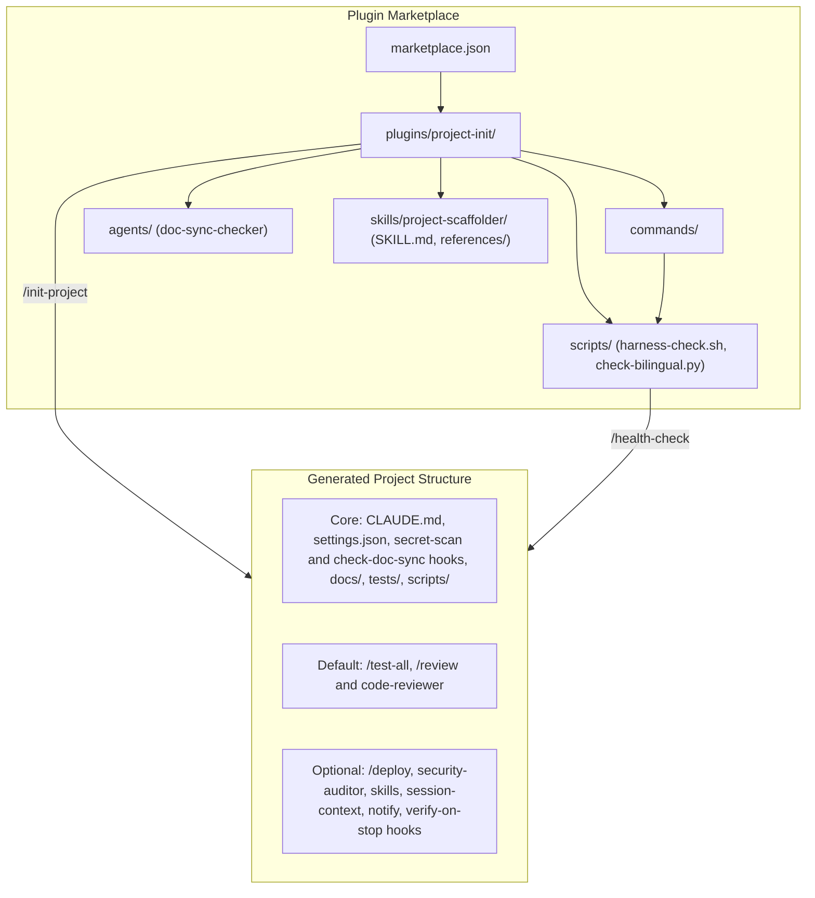
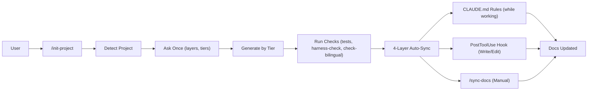

# Architecture

---

# English

## System Overview

project-init is a Claude Code plugin that provides project structure initialization and automated documentation synchronization.
It is distributed as a marketplace repository containing a single plugin (`project-init`).
When users run `/init-project`, it detects the existing project and generates a harness by tier: Core always, Default unless unchecked, Optional only when checked (ADR-009).

## Components

### Plugin Layer
- **plugins/project-init/commands/** -- Slash commands (init-project, sync-docs, generate-readme, generate-changelog, add-adr, add-module, add-runbook, add-reference-doc, health-check, migrate-hooks). Each `.md` file defines one command as a goal, inputs, rules, an output contract, a runnable check, and a report (ADR-009).
- **plugins/project-init/agents/** -- doc-sync-checker agent. A read-only documentation audit that `/sync-docs` launches once for larger projects; it inherits the session model, runs at `effort: medium`, and reports every finding with severity and confidence.
- **plugins/project-init/scripts/** -- Deterministic checks the commands run, referenced as `${CLAUDE_PLUGIN_ROOT}/scripts/<name>`: `harness-check.sh` (harness checks and score for `/health-check`, hook-contract detection with `--contract-only` for `/migrate-hooks` and `/init-project`) and `check-bilingual.py` (ADR-001/002 structure of bilingual documents).
- **plugins/project-init/skills/** -- project-scaffolder skill. `SKILL.md` holds the tiered layout and the single-source sections `## CLAUDE.md Quality Criteria`, `## CLAUDE.md Anti-Patterns`, and `## Module CLAUDE.md Coverage`; `references/` holds the templates, including the shared writing-style-guide.

### Repository Harness Layer
- **.claude/hooks/** -- `secret-scan.sh` (PreToolUse gate on `git commit`: scans what the commit will contain, renames included, and blocks with exit 2; a commit it cannot scan, such as one without a working python3, goes through with a warning in `systemMessage` and `additionalContext`), `check-doc-sync.sh` (PostToolUse: notes a plugin without a root CLAUDE.md via `additionalContext`, and checks an edit in a linked worktree against that worktree; its header carries the `project-init:module-coverage` marker), `session-context.sh` (SessionStart: plugin version and version drift across the manifests, README, and CHANGELOG), `test-gate.sh` (Stop gate: runs `bash tests/run-all.sh` when a turn ends on a working tree that changed since its last run and hands the failure summary back to Claude with exit 2; it records every run's tree fingerprint, green or red, under `${TMPDIR:-/tmp}`, tests the linked worktree that the event's `cwd` names when it belongs to this repository, and is registered with a 180-second `timeout`; a run the timeout kills is reported once in a `systemMessage` on the next Stop). Hooks that need the event read its JSON from stdin (session-context.sh needs none), and all are registered as `bash "$CLAUDE_PROJECT_DIR"/.claude/hooks/<name>.sh`; gates have nothing after `.sh`, observational hooks end with `2>/dev/null || true` (ADR-004, ADR-008, ADR-009).
- **.claude/commands/** -- review (runs the suite first, then reports every issue with severity and confirmed/suspected), test-all (manual suite run that fixes failures at their cause), deploy (release, user-invoked only).
- **tests/** -- `run-all.sh` sources every `tests/**/test-*.sh`: hook contract and registration, secret patterns read from the hook's `PATTERNS`, plugin structure (version sync across manifests, README, and CHANGELOG; template copies identical to the repository files), reference-doc skeletons, `harness-check.sh` against fixture projects, the bilingual structure of the repository's bilingual docs, and cross-file prompt contracts (rules one plugin file states and others must not contradict).

### Generated Project Layer
- **Core** -- Root CLAUDE.md, `.claude/settings.json` (deny list and hook registrations), `secret-scan.sh` and `check-doc-sync.sh`, `scripts/setup.sh` and `scripts/install-hooks.sh`, docs and `docs/reference/`, `tests/`, README, CHANGELOG, `.editorconfig`, `.gitignore`, `.env.example`, and `.mcp.json` with no servers. Module CLAUDE.md files only for modules with rules the code does not show.
- **Default** -- `/test-all`, and `/review` with the code-reviewer agent.
- **Optional** -- `/deploy`, the security-auditor agent, the code-review, refactor, and release skills, and the session-context, notify, and verify-on-stop hooks.

### Documentation Layer
- **docs/architecture.md** -- Bilingual architecture document (this file).
- **docs/decisions/** -- Architecture Decision Records (ADRs).
- **docs/runbooks/** -- Operational runbooks.
- **docs/onboarding.md** -- Developer onboarding guide.

### Distribution Layer
- **.claude-plugin/marketplace.json** -- Marketplace manifest.
- **plugins/project-init/.claude-plugin/plugin.json** -- Plugin manifest.

## Full Architecture Diagram

## Data Flow Summary

## Key Design Decisions

- **Marketplace structure** -- Plugins organized under `plugins/` subdirectory to support multiple plugins from a single repository.
- **Markdown-based definitions** -- All commands/skills/agents defined as Markdown for easy version control and code review.
- **4-layer auto-sync** -- In a generated project, the CLAUDE.md Auto-Sync Rules (guidance Claude applies while it works, when code changes), the PostToolUse hook, and the plugin's `/project-init:sync-docs` command keep documentation current, and a fourth layer, the commit-msg hook, keeps AI co-author trailers out of the commit history; the rules are guidance, and the hooks are the deterministic part.
- **Report-all review** -- Generated reviewers, the doc-sync-checker agent, and this repository's `/review` report every finding with severity and confidence, and filtering happens downstream, because a find-time confidence cutoff makes the model drop real findings (ADR-009).
- **Tiered generation** -- `/init-project` asks once which Default and Optional components to generate, so a consumer does not pay context for generic skills it does not use (ADR-009).
- **Deterministic checks in scripts** -- Scoring, hook-contract detection, and bilingual structure checks run as bundled scripts, so they give the same result on every model; the model keeps the judgment calls (ADR-009).
- **Bilingual support** -- All user-facing documents (README, CHANGELOG, architecture, ADR, runbook) provided in Korean/English. Shared writing-style-guide ensures consistency, and `check-bilingual.py` checks the structure.
- **Mermaid architecture diagrams** -- All architecture flows use Mermaid flowchart instead of ASCII box diagrams: GitHub renders them natively and doc-sync regeneration stays reliable (ADR-007).

## Operations
- Release: see [docs/runbooks/release.md](runbooks/release.md) for the maintainer-side version bump and tag procedure
- Update or remove the plugin: see [docs/runbooks/update-from-marketplace.md](runbooks/update-from-marketplace.md) for the consumer-side procedure
- Architecture decisions: see [docs/decisions/](decisions/) -- ADR-001 (bilingual policy), ADR-002 (HTML anchor navigation), ADR-003 (shared writing-style-guide), ADR-004 (hook non-blocking failure), ADR-005 (implementation reference docs), ADR-006 (hybrid detection + confirmation), ADR-007 (Mermaid architecture diagrams), ADR-008 (right-sized harness), ADR-009 (Opus 5.5 harness alignment)

---

# 한국어

## 시스템 개요

project-init은 Claude Code 플러그인으로, 프로젝트 구조 초기화와 문서 자동 동기화를 제공합니다.
마켓플레이스 저장소로 배포되며, 단일 플러그인(`project-init`)을 포함합니다.
사용자가 `/init-project`을 실행하면 기존 프로젝트를 감지하고 티어별로 하네스를 생성합니다: Core는 항상, Default는 해제하지 않는 한, Optional은 선택할 때만 생성합니다(ADR-009).

## 구성 요소

### 플러그인 계층
- **plugins/project-init/commands/** -- 슬래시 커맨드 (init-project, sync-docs, generate-readme, generate-changelog, add-adr, add-module, add-runbook, add-reference-doc, health-check, migrate-hooks). 각 `.md` 파일이 하나의 커맨드를 목표, 입력, 규칙, 출력 계약, 실행 가능한 검사, 보고로 정의합니다(ADR-009).
- **plugins/project-init/agents/** -- doc-sync-checker 에이전트. 규모가 큰 프로젝트에서 `/sync-docs`가 한 번 실행하는 읽기 전용 문서 감사입니다. 세션 모델을 상속하고 `effort: medium`으로 실행되며, 모든 finding을 심각도와 확신도와 함께 보고합니다.
- **plugins/project-init/scripts/** -- 커맨드가 실행하는 결정론적 검사로, `${CLAUDE_PLUGIN_ROOT}/scripts/<name>`으로 참조합니다: `harness-check.sh`(`/health-check`용 하네스 검사와 점수, `--contract-only`로 `/migrate-hooks`와 `/init-project`가 쓰는 훅 계약 감지)와 `check-bilingual.py`(이중 언어 문서의 ADR-001/002 구조 검사).
- **plugins/project-init/skills/** -- project-scaffolder 스킬. `SKILL.md`에는 티어별 구조와 단일 출처 섹션 `## CLAUDE.md Quality Criteria`, `## CLAUDE.md Anti-Patterns`, `## Module CLAUDE.md Coverage`가 있고, `references/`에는 공통 writing-style-guide를 포함한 템플릿이 있습니다.

### 저장소 하네스 계층
- **.claude/hooks/** -- `secret-scan.sh`(`git commit` PreToolUse 게이트: 이름을 바꾼 파일을 포함해 커밋에 들어갈 내용을 검사하고 exit 2로 차단. 동작하는 python3가 없을 때처럼 검사할 수 없는 커밋은 `systemMessage`와 `additionalContext` 경고와 함께 통과), `check-doc-sync.sh`(PostToolUse: 루트 CLAUDE.md가 없는 플러그인을 `additionalContext`로 알리고, linked worktree에서 편집한 파일은 그 worktree 기준으로 검사. 헤더에 `project-init:module-coverage` 마커가 있음), `session-context.sh`(SessionStart: 플러그인 버전과 매니페스트·README·CHANGELOG 사이의 버전 드리프트), `test-gate.sh`(Stop 게이트: 마지막 실행 이후 바뀐 작업 트리에서 턴이 끝나면 `bash tests/run-all.sh`를 실행하고 실패 요약을 exit 2로 Claude에 돌려줌. 통과든 실패든 실행마다 트리 fingerprint를 `${TMPDIR:-/tmp}` 아래에 기록하고, 이벤트의 `cwd`가 가리키는 linked worktree가 이 저장소에 속하면 그 worktree를 검사하며, 180초 `timeout`으로 등록. timeout으로 중단된 실행은 다음 Stop에서 `systemMessage`로 한 번 알림). 이벤트가 필요한 훅은 stdin에서 이벤트 JSON을 읽고(session-context.sh는 필요 없음), 모든 훅은 `bash "$CLAUDE_PROJECT_DIR"/.claude/hooks/<name>.sh` 형식으로 등록합니다. 게이트는 `.sh` 뒤에 아무것도 두지 않고, 관찰형 훅은 `2>/dev/null || true`로 끝납니다(ADR-004, ADR-008, ADR-009).
- **.claude/commands/** -- review(스위트를 먼저 실행한 뒤 모든 이슈를 심각도와 confirmed/suspected로 보고), test-all(실패를 원인에서 고치는 수동 스위트 실행), deploy(릴리스, 사용자만 호출).
- **tests/** -- `run-all.sh`가 모든 `tests/**/test-*.sh`를 source합니다: 훅 계약과 등록, 훅의 `PATTERNS`에서 읽은 시크릿 패턴, 플러그인 구조(매니페스트·README·CHANGELOG 버전 동기화, 저장소 파일과 동일한 템플릿 사본), 참조 문서 스켈레톤, 픽스처 프로젝트에 대한 `harness-check.sh`, 저장소 이중 언어 문서의 구조, 파일 사이의 프롬프트 계약(한 플러그인 파일이 정한 규칙과 다른 파일이 어긋나지 않는지).

### 생성 프로젝트 계층
- **Core** -- 루트 CLAUDE.md, `.claude/settings.json`(deny 목록과 훅 등록), `secret-scan.sh`와 `check-doc-sync.sh`, `scripts/setup.sh`와 `scripts/install-hooks.sh`, 문서와 `docs/reference/`, `tests/`, README, CHANGELOG, `.editorconfig`, `.gitignore`, `.env.example`, 서버가 없는 `.mcp.json`. 모듈 CLAUDE.md는 코드가 보여 주지 않는 규칙이 있는 모듈에만 생성합니다.
- **Default** -- `/test-all`, 그리고 code-reviewer 에이전트와 함께하는 `/review`.
- **Optional** -- `/deploy`, security-auditor 에이전트, code-review·refactor·release 스킬, session-context·notify·verify-on-stop 훅.

### 문서 계층
- **docs/architecture.md** -- 이중언어 아키텍처 문서 (이 파일).
- **docs/decisions/** -- ADR(Architecture Decision Records).
- **docs/runbooks/** -- 운영 런북.
- **docs/onboarding.md** -- 개발자 온보딩 가이드.

### 배포 계층
- **.claude-plugin/marketplace.json** -- 마켓플레이스 매니페스트.
- **plugins/project-init/.claude-plugin/plugin.json** -- 플러그인 매니페스트.

## 전체 아키텍처 다이어그램

## 데이터 흐름 요약

## 주요 설계 결정

- **마켓플레이스 구조** -- 플러그인을 `plugins/` 하위 디렉토리로 구성하여 단일 저장소에서 여러 플러그인을 관리할 수 있도록 확장성 확보.
- **Markdown 기반 정의** -- 모든 커맨드/스킬/에이전트를 Markdown으로 정의하여 버전 관리와 코드 리뷰가 용이하도록 함.
- **4계층 자동 동기화** -- 생성 프로젝트에서는 CLAUDE.md 자동 동기화 규칙(Claude가 작업하면서 코드가 바뀔 때 적용하는 지침), PostToolUse 훅, 플러그인의 `/project-init:sync-docs` 커맨드가 문서를 최신 상태로 유지하고, 네 번째 계층인 commit-msg 훅은 AI 공동 작성자 트레일러가 커밋 기록에 남지 않게 함. 규칙은 지침이고, 결정론적으로 동작하는 부분은 훅.
- **모든 finding 보고 리뷰** -- 생성되는 리뷰어, doc-sync-checker 에이전트, 이 저장소의 `/review`는 모든 finding을 심각도와 확신도와 함께 보고하고 필터링은 다운스트림에서 함. 찾는 단계에서 확신도 기준으로 거르면 모델이 실제 finding을 누락하기 때문 (ADR-009).
- **티어 생성** -- `/init-project`가 생성할 Default·Optional 구성 요소를 한 번에 물어, 소비자가 쓰지 않는 범용 스킬에 컨텍스트를 지불하지 않도록 함 (ADR-009).
- **스크립트로 옮긴 결정론적 검사** -- 점수 계산, 훅 계약 감지, 이중 언어 구조 검사를 번들 스크립트로 실행해 어떤 모델에서도 같은 결과를 냄. 판단이 필요한 부분은 모델이 맡음 (ADR-009).
- **이중언어 지원** -- 모든 사용자 대면 문서(README, CHANGELOG, architecture, ADR, runbook)를 한국어/영어 병기로 제공. 공통 writing-style-guide로 일관성을 유지하고, `check-bilingual.py`로 구조를 검사.
- **Mermaid 아키텍처 다이어그램** -- 모든 아키텍처 흐름은 ASCII 박스 다이어그램 대신 Mermaid flowchart를 사용: GitHub이 네이티브로 렌더링하며 문서 동기화 재생성이 안정적으로 유지됨 (ADR-007).

## 운영
- 릴리스: 메인테이너 측 버전 갱신과 태그 절차는 [docs/runbooks/release.md](runbooks/release.md) 참조
- 플러그인 업데이트 또는 제거: 소비자 측 절차는 [docs/runbooks/update-from-marketplace.md](runbooks/update-from-marketplace.md) 참조
- 아키텍처 결정: [docs/decisions/](decisions/) 참조 -- ADR-001(이중언어 정책), ADR-002(HTML 앵커 내비게이션), ADR-003(공유 writing-style-guide), ADR-004(훅 비차단 실패), ADR-005(구현 참조 문서), ADR-006(하이브리드 감지 + 확인), ADR-007(Mermaid 아키텍처 다이어그램), ADR-008(하네스 적정화), ADR-009(Opus 5.5 하네스 정렬)
